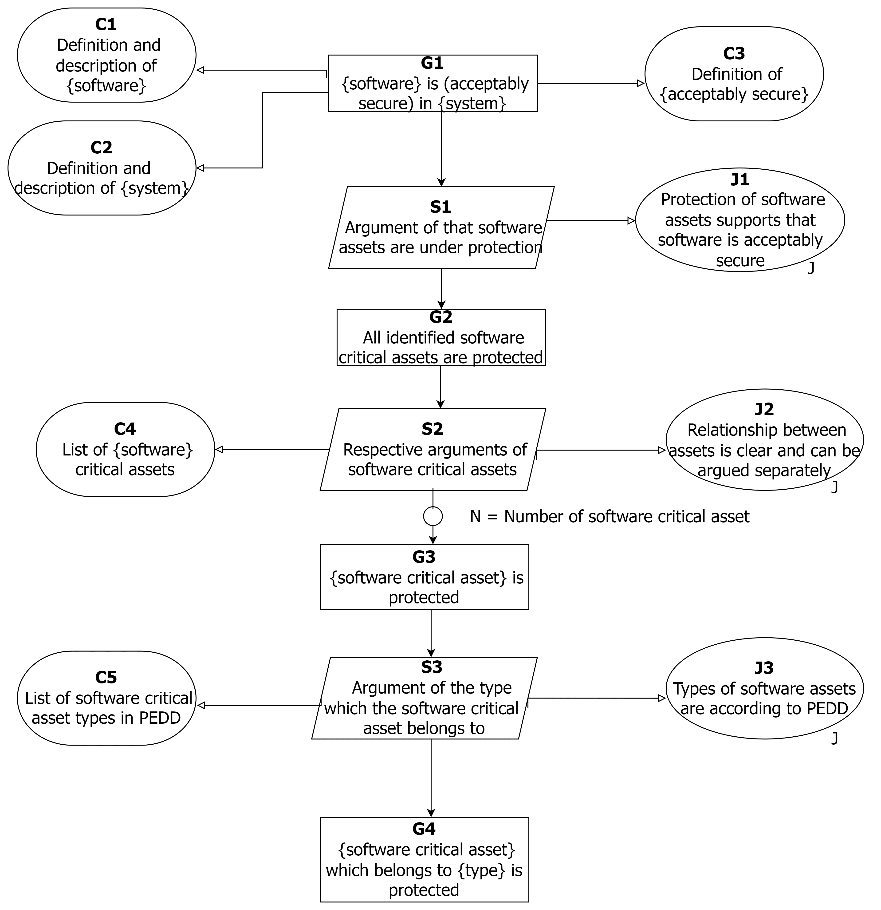

# Assurance Case Pattern (ACP) and Assurance Case (AC)

## IM_software

### 1. `IM_software_ACP.png`: the Assurance Case Pattern

A generic GSN template with placeholders in curly braces: `{software}`, `{system}`, `{software critical asset}` and `{type}`.

**Logic of the pattern**

- **G1** claims the software is acceptably secure in the system.
- **S1** argues this is because its assets are protected.
- **G2** says all identified critical assets are protected.
- **S2** splits that into one goal **G3** per asset. The circle marked "N = number of software critical asset" shows this repeats N times.
- **S3** then argues over the asset's type according to PEDD, which leads to **G4**.

The pattern also carries the contexts that need defining (**C1 to C5**) and justifications (**J1 to J3**).

### 2. `IM_Software_AC.png`: the Assurance Case instantiated from the pattern

This is the ground truth in `Ground_Truth_AC.csv`.

- **G1** becomes "IM server software is acceptable secure in system".
- **C1 and C2** describe the system: corporation X, built in VC, running on Windows XP with fewer than 500 users.
- **C3** defines "acceptably secure" as a user-information leak probability below 0.05%.
- **C4** lists the 6 critical assets, which become **G3.1 to G3.6**:
  1. sign-up information
  2. sign-up process
  3. user account information
  4. authentication information
  5. login process
  6. chat log
- **C5.1 and C5.2** list the PEDD asset types: process, data exchange, data storage.
- Only **G3.1** and **G3.5** are developed further, through **S3.1** and **S3.2** to **G4.1** and **G4.2**. These point to a separate "software related threat argument pattern". The other four G3 goals are left undeveloped.

