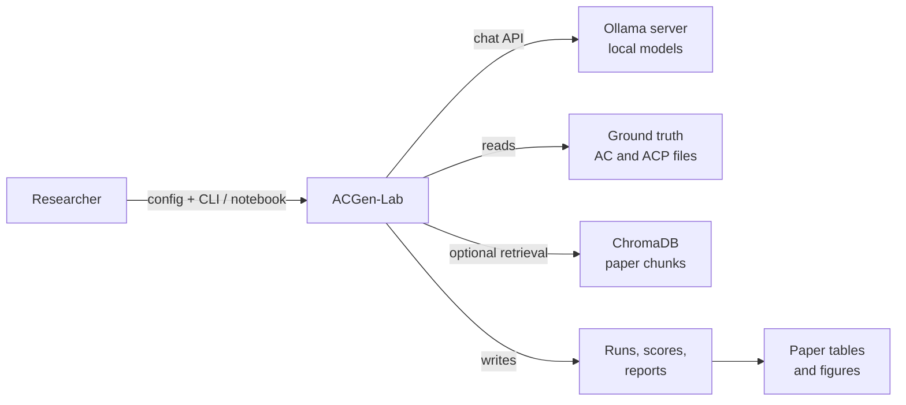
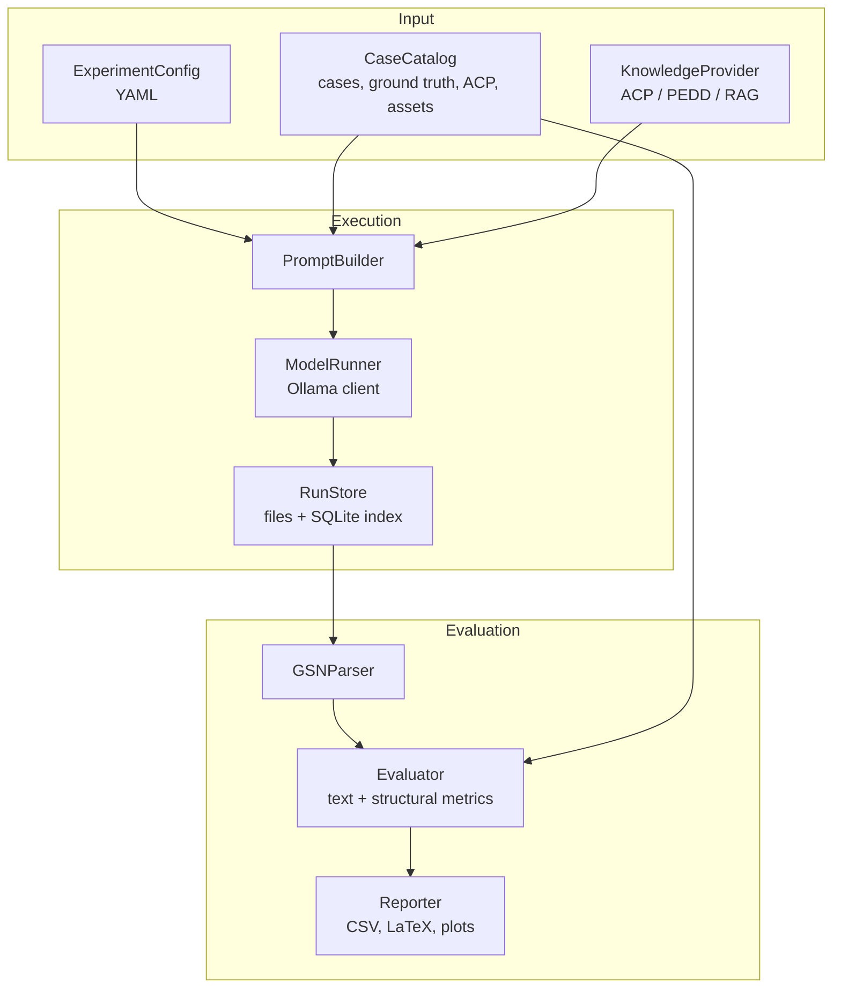
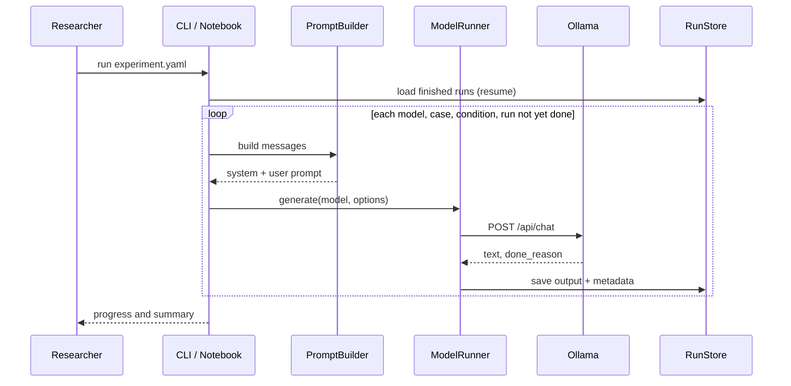
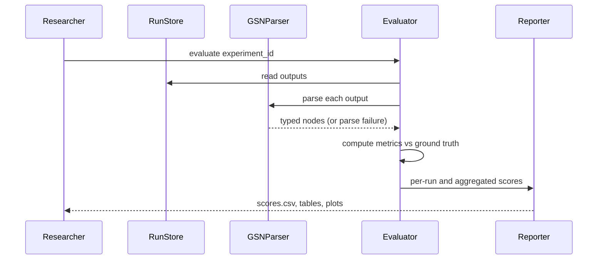

# High-Level Design

## 1. Purpose and scope

1. Runs the same experiment on **local Ollama models**.
2. Adds **knowledge conditions**, for example giving the model the assurance case pattern (ACP) or PEDD asset types, so the "without" and "with S.E knowledge" settings can be compared on equal terms.
3. Parses the generated trees and scores them with **structural metrics** as well as text-overlap metrics.
4. Produces tables and plots that can go straight into the paper.

**In scope:** prompt construction, model execution, output storage, GSN parsing, metrics, reporting. 

**Out of scope:** fine-tuning, training new models, graphical GSN rendering (optional later), and the SLR chatbot (separate project).

---

## 2. Goals and non-goals

| Goals | Non-goals |
| --- | --- |
| Reproduce the IM_Software baseline with Ollama models | Beating GPT-4 scores |
| Compare conditions (baseline, +ACP, +ACP+PEDD, +RAG) fairly | Building a general GSN editor |
| Record every setting so a run can be repeated | Hosting a multi-user service |
| Score structure, not only wording | Automatic proof of assurance-case validity |
| Run on a single workstation, resumable after a crash | Cloud deployment |

---

## 3. Context



---

## 4. Architecture



### 4.1 Components

| Component | Responsibility | Notes |
| --- | --- | --- |
| **ExperimentConfig** | Declares models, cases, conditions, runs, temperature, seed, max tokens | One YAML file defines one experiment; it is copied into the output folder |
| **CaseCatalog** | Holds each case: name, user prompt, ground-truth AC, ACP (if any), critical-asset list | Seeded from `Ground_Truth_AC.csv`; IM_Software first |
| **KnowledgeProvider** | Supplies extra context for a condition: ACP text, PEDD asset types, or retrieved chunks | RAG variant reuses `CPdfRAGChroma` |
| **PromptBuilder** | Builds system and user messages for a (case, condition) pair | Baseline prompt stays identical to the original notebooks |
| **ModelRunner** | Calls Ollama `/api/chat`, applies options, strips `<think>` blocks, records `done_reason` | Wraps `COllamaServer`; skips models that are not installed |
| **RunStore** | Saves raw output and metadata for every run; lets an interrupted experiment resume | Files for outputs, SQLite for the index |
| **GSNParser** | Turns dash-trees, bold-numbered lists and `G1: ...` lines into typed nodes | Must handle the formats seen in the GPT runs |
| **Evaluator** | Computes metrics per run, then aggregates per model and condition | See section 6 |
| **Reporter** | Writes `scores.csv`, summary tables, LaTeX snippets and box plots | Variance across runs is reported, not only means |

---

## 5. Experimental design

### 5.1 Conditions

| ID | Condition | Extra knowledge in the prompt |
| --- | --- | --- |
| C0 | Baseline (no S.E knowledge) | None; same prompt as the original study |
| C1 | + Pattern | The assurance case pattern (ACP) skeleton |
| C2 | + Pattern + PEDD | ACP plus the PEDD asset types |
| C3 | + RAG | Chunks retrieved from the paper collection |

The exact content of the original "with S.E knowledge" condition should be confirmed before fixing C1 and C2.

### 5.2 Factors

- **Model:** for example `qwen2.5:3b`, `qwen3:4b`, `gemma3:4b`, plus one larger model for a size comparison.
- **Case:** IM_Software first, then GPCA, BlueROV2, DeepMind, ACAS Xu.
- **Runs:** 5 per (model, case, condition) to match the original.
- **Sampling:** `temperature=1` for comparability. A second sweep at `temperature=0` with a fixed seed measures the effect of randomness.

---

## 6. Evaluation design

### 6.1 Metrics

| Group | Metric | Purpose |
| --- | --- | --- |
| Text overlap (legacy) | BLEU, difflib ratio, TF-IDF cosine | Comparable with the original paper |
| Format validity | Parses without error; has a top goal; has at least one strategy | Catches outputs from small models that ignore the format |
| Node mix | Counts of goals, strategies, solutions, contexts, assumptions, justifications | Compares structure with the ground truth |
| Asset coverage | Share of the 6 ground-truth critical assets that appear as goals | Main content metric for IM_Software |
| Pattern conformance | Top goal, then strategy, then one goal per asset, then type argument | Checks the ACP shape was followed |
| Context fidelity | Whether stated context values (for example the 0.05% threshold) appear | Shows whether given knowledge was used |
| Stability | Mean and standard deviation across runs | Quantifies the effect of sampling |

### 6.2 Caveat

BLEU and string similarity reward matching words. A structurally correct case written in different words scores near zero, as the original results show. Structural metrics should be the headline numbers, with the legacy metrics kept for comparison. Manual review of a sample of outputs is advised to check that the automatic metrics agree with a human reader.

---

## 7. Key flows

### 7.1 Run an experiment



### 7.2 Evaluate and report



---

## 8. Data design

### 8.1 Folder layout

```
acgen_lab/
  experiments/
    exp_2026-11-25_im_baseline/
      config.yaml              # frozen copy of the settings used
      runs/
        <model>/<case>/<condition>/
          1.txt  1.json        # output + metadata (seed, options, done_reason, timing)
          2.txt  2.json ...
      scores.csv
      summary.csv
      report/                  # tables, figures
  data/
    Ground_Truth_AC.csv
    cases/IM_Software/{ground_truth.txt, acp.txt, assets.json}
  src/ ...
```

### 8.2 Run index (SQLite, optional)

| Table | Key fields |
| --- | --- |
| `runs` | id, experiment, model, model_digest, case, condition, run_no, seed, temperature, done_reason, seconds, path |
| `scores` | run_id, metric, value |

Files remain the source of truth; SQLite makes queries and resuming fast.

---

## 9. Interfaces

| Interface | Detail |
| --- | --- |
| Ollama | `POST /api/chat` with `stream:false`, `think:false`, options `temperature`, `num_predict`, `num_ctx`, `seed`; `GET /api/tags` to check installed models |
| CLI | `acgen run <config>`, `acgen evaluate <experiment>`, `acgen report <experiment>`, `acgen models` |
| Notebook | Thin wrapper over the same functions for inspecting single runs |
| Ground truth | CSV with columns `Case`, `AC`, extended per case by ACP and asset files |

---

## 10. Non-functional requirements

| Area | Requirement |
| --- | --- |
| Reproducibility | Config, seed, model name and model digest stored with every run; fixed prompts under version control |
| Resumability | A crash or timeout loses at most one run; re-running the command continues |
| Performance | Sequential runs are acceptable (small models); optional timeout and retry per call |
| Truncation | `done_reason == "length"` is flagged and counted, not silently scored |
| Portability | Python 3.10+, runs on a laptop with Ollama installed |
| Privacy and security | Local only; no API keys needed; no placeholder keys left in code |
| Maintainability | One module per component; unit tests for the parser and metrics |

---

## 11. Technology

| Need | Choice |
| --- | --- |
| Language | Python |
| LLM runtime | Ollama (reuse `COllamaServer`) |
| Config | YAML |
| Storage | Files plus SQLite |
| Metrics | `sacrebleu`, `difflib`, `scikit-learn`, plus custom structural scoring |
| Reporting | `pandas`, `matplotlib`, LaTeX table export |
| RAG (C3) | Existing `CPdfRAGChroma` with ChromaDB and `nomic-embed-text` |

---

## 12. Risks and mitigations

| Risk | Impact | Mitigation |
| --- | --- | --- |
| Small models ignore the dash-tree format | Many parse failures | Count failures as a result; add a lenient parser; keep a larger model in the comparison |
| Output formats vary between runs | Parser misses nodes | Build parser tests from the real GPT outputs already in the repo |
| Ground truth exists in full only for IM_Software | Weak cross-case claims | Start with IM_Software; add other cases only when their ground truth and asset lists exist |
| Text metrics mislead | Wrong conclusions | Make structural metrics primary and sample outputs manually |
| Randomness hides small effects | Inconclusive comparisons | 5 or more runs, report spread, add a `temperature=0` sweep |
| Context window too small for ACP or RAG prompts | Truncated or ignored knowledge | Keep `num_ctx` explicit; log prompt length |
| Model updates change results | Not repeatable later | Store the model digest with each run |

---

## 13. Delivery plan

| Phase | Deliverable | Done when |
| --- | --- | --- |
| 0 | Baseline script (done: `replicate_im_software_ollama.py`) | 5 runs per model saved for IM_Software |
| 1 | Config, CaseCatalog, RunStore, resumable runner | An experiment resumes after interruption |
| 2 | GSNParser with tests | Parses all GPT-4o and GPT-4 Turbo IM_Software outputs |
| 3 | Structural metrics and Evaluator | Asset coverage and conformance computed for all runs |
| 4 | Knowledge conditions C1 and C2 | ACP and PEDD prompts running |
| 5 | Reporter | `scores.csv`, summary table and plots generated in one command |
| 6 | Extra cases (GPCA, BlueROV2, DeepMind, ACAS Xu) | Ground truth and asset lists added per case |
| 7 | Optional: RAG condition C3, GSN diagram rendering | Retrieval-augmented runs scored |

---

## 14. Open questions

1. What exactly does the original "with S.E knowledge" condition supply (pattern, PEDD types, documents)?
2. Which Ollama models are in scope, and what are the GPU and RAM limits on the test machine?
3. Should the GPT results be re-scored with the new structural metrics so both sides use the same yardstick?
4. Are ground-truth ACs and asset lists available for the other four systems?
5. Is the framework to be released with the paper (open-source repository), or kept internal?